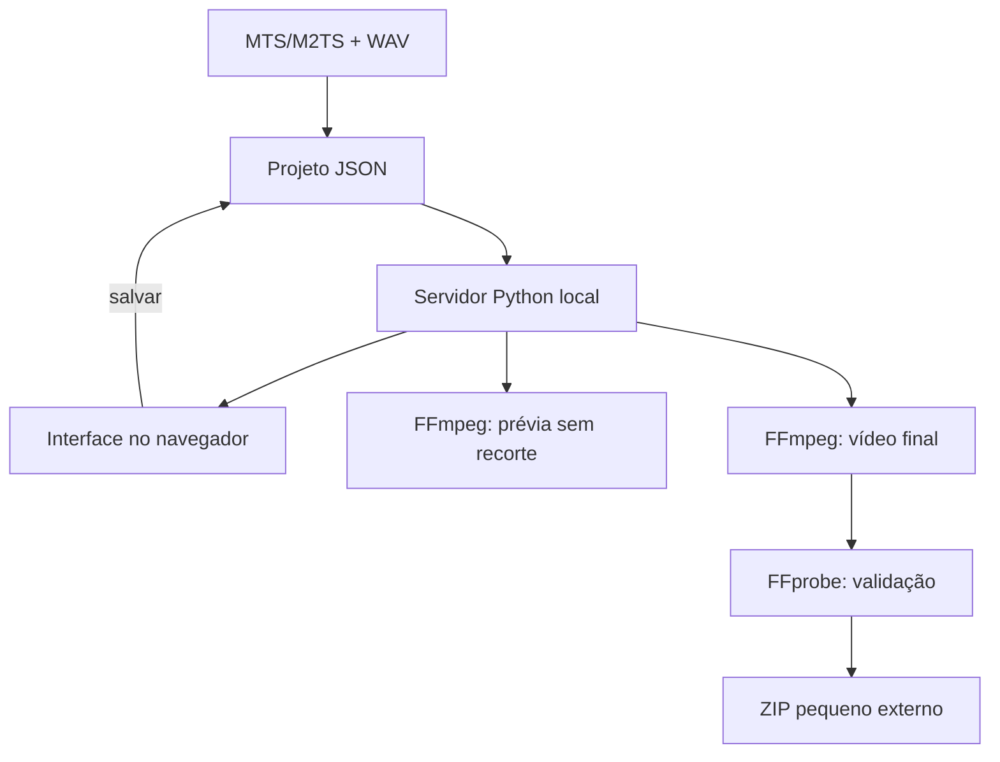

# Arquitetura

## Componentes

`coral_editor.py` concentra a lógica de projeto, validação, comandos FFmpeg, servidor local e arquivamento. `editor.html` contém a interface e usa apenas JavaScript nativo. Não há dependências Python externas.

No Windows, `Editor de Concertos.vbs` inicia `pythonw.exe` sem console permanente e abre um seletor de pasta. `instalar.bat` cria a `.venv`; `Criar atalho do Editor.bat` instala o atalho com o ícone do Clube Paineiras.



## Serviço local e instância única

O servidor escuta apenas `127.0.0.1:8765`. Um novo lançamento consulta `/api/identity`: se a mesma pasta já estiver aberta, somente reabre o navegador; se for outro concerto, solicita o encerramento da instância atual. O endpoint `/api/shutdown`, acionado por **Encerrar editor**, recusa o desligamento durante renderização e libera o socket ao terminar.

## Modelo temporal

O timecode operacional pertence ao WAV do Tascam. A relação linear entre as fontes é:

```text
tascam = offset + clock_ratio × camera
```

Os marcadores de música e o fim musical são armazenados em segundos absolutos do Tascam. As margens de corte são convertidas para cada relógio antes de construir os filtros.

## Prévia e enquadramento

A prévia é gerada sem crop, em 854×480. O navegador aplica uma transformação visual equivalente ao recorte final. Isso permite ajustar zoom e posição sem nova codificação. A renderização final aplica `crop` e `scale` diretamente aos arquivos originais.

## Persistência

O estado editável fica em `_CoralEditor/projeto.json`. As gravações originais nunca são modificadas. Escritas JSON usam arquivo temporário e substituição atômica.

Depois da exportação, o projeto é copiado para um ZIP em `_CoralEditor_Arquivos`, ao lado da pasta do concerto. A mídia não entra nesse pacote.

## Renderização

O pipeline de vídeo aplica, conforme o projeto:

1. trim temporal;
2. desentrelaçamento BWDIF, quando necessário;
3. recorte e escala, somente na versão final;
4. cartelas ASS;
5. H.264 em uma única recodificação.

O áudio do Tascam passa por trim, reamostragem para 48 kHz, correção linear de relógio e ganho global. O áudio da câmera não é mapeado para a saída.

Todos os processos FFmpeg e FFprobe recebem entrada padrão desabilitada. No Windows, usam `CREATE_NO_WINDOW` e `STARTUPINFO` oculto; comandos FFmpeg também recebem `-nostdin`. Logs e erros continuam preservados.

## Compatibilidade

Projetos com esquema `coral-paineiras-project-v1` recebem os campos novos em memória e são salvos como `concertos-coral-project-v2`. A migração preserva os valores existentes.
